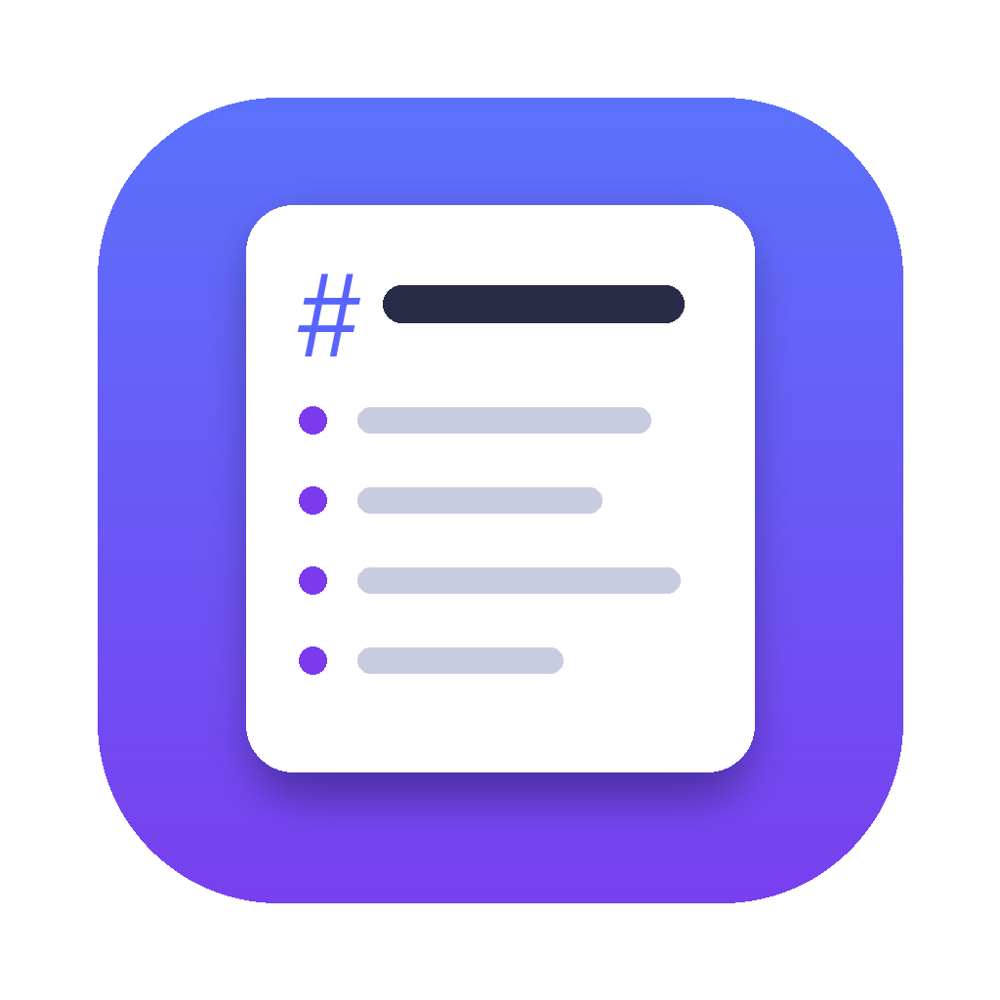

# Prompt Box

**Paste a messy prompt. Get a structured one back.**

A floating window that lives in the corner of your screen and reformats rough prompts into Markdown you can review before sending to coding agents (Claude, ChatGPT, Cursor, etc.). Works over every app — including full-screen terminals.



---

## Contents

- [Why](#why)
- [Two modes](#two-modes)
- [Features](#features)
- [Install](#install)
- [Set up an API key](#set-up-an-api-key)
- [Usage](#usage)
- [Configuration](#configuration)
- [How it works](#how-it-works)
- [Platform notes](#platform-notes)
- [Troubleshooting](#troubleshooting)

---

## Why

Labeled sections (`Goal`, `Constraints`, `Done when`) can make requirements easier to review. Prompt Box drafts that structure in one keypress. The result still needs review: an LLM can omit constraints or change meaning.

---

## Two modes

| Mode | Input | Output |
|---|---|---|
| **Structure** | A rough prompt you already wrote | The same requirements, reorganized into labeled Markdown sections |
| **Build** | A plain-English description of what you want | A full execution prompt with Goal, Features, Steps, Acceptance criteria, and Assumptions |

### Structure output example
```
## Goal
Add dark mode toggle to the settings page.

## Constraints
- Use the existing `useTheme` hook, don't introduce a new one
- No new dependencies

## Done when
- Toggle visible in Settings → Appearance
- `localStorage` key `theme` is set to `"dark"` or `"light"` on change
- All existing Cypress tests still pass
```

### Build output example
```
## Goal
Build a habit tracker web app with streaks and a weekly progress chart.

## Features
### Daily streaks
Mark a habit done for today; streak counts consecutive days.
  - Acceptance: streak resets after a missed day

### Weekly progress chart
Bar chart of completions for the last 7 days.
  - Acceptance: shows 7 bars, today on the right

## Design
- Background `#0F172A`, accent mint green `#3EB489`

## Assumptions
- Chart drawn with plain SVG, no charting library
- Local storage for persistence; no backend
```

---

## Features

- **Floats above everything** — appears over full-screen terminals, Claude, ChatGPT desktop, VS Code. macOS uses an NSPanel; Windows uses an always-on-top overlay.
- **Three sizes** — orb (56×56 bubble), panel (320×460 corner), full (1180×760 workspace)
- **Literal detail check** — highlights missing numbers, file paths, hex colors, or flags. Case-sensitive for identifiers and paths. This is a heuristic, not proof that meaning or every requirement survived
- **History sidebar** — every conversion saved locally as `<timestamp>.md` + `<timestamp>.original.txt`
- **Five API providers** — OpenAI-compatible; availability, pricing, and limits depend on the provider:

| Provider | Get a key |
|---|---|
| NVIDIA | [build.nvidia.com](https://build.nvidia.com) |
| OpenRouter (free models) | [openrouter.ai/keys](https://openrouter.ai/keys) |
| Groq | [console.groq.com/keys](https://console.groq.com/keys) |
| OpenAI | [platform.openai.com/api-keys](https://platform.openai.com/api-keys) |
| Custom | Any OpenAI-compatible endpoint |

- **Models pre-configured** — sensible defaults for every provider; override in Settings if you want
- **API keys stored securely** — macOS Keychain / Windows Credential Manager, never in plain text

---

## Install

### macOS

```bash
pip3 install pywebview pyobjc-framework-Cocoa
python3 promptbox.py
```

**Or as an app:** drag `Prompt Box.app` to `/Applications` if provided, or build one:
```bash
pip3 install py2app   # then follow standard py2app packaging
```

### Windows

Double-click `promptbox_windows.cmd`. On first run it installs dependencies automatically:
```
pywebview   keyring   pyperclip
```

Requirements: Python 3.10–3.13 from [python.org](https://python.org). Python 3.14 may not yet be supported by pywebview's Windows backend.

---

## Set up an API key

Choose a provider and check its current pricing, model access, and limits before use. Defaults are editable starting points, not a guarantee of availability or free access. Prompts are sent to the selected endpoint; only use a provider appropriate for their contents.

### NVIDIA
Default models: `meta/llama-3.1-8b-instruct` · `meta/llama-3.3-70b-instruct`

1. Go to [build.nvidia.com](https://build.nvidia.com) and create a free account
2. Open any model page → click **Get API Key** → copy it
3. In Prompt Box: click ⚙ → select **NVIDIA** → paste the key → **Save**

### Groq
Default models: `llama-3.1-8b-instant` · `llama-3.3-70b-versatile`

1. Go to [console.groq.com/keys](https://console.groq.com/keys) and create a free account
2. Click **Create API Key** → copy it
3. In Prompt Box: click ⚙ → select **Groq** → paste the key → **Save**

### OpenRouter (access to hundreds of models)
Default models: `meta/llama-3.1-8b-instruct:free` · `meta/llama-3.3-70b-instruct:free`

1. Go to [openrouter.ai/keys](https://openrouter.ai/keys) and sign in
2. Click **Create Key** → copy it
3. In Prompt Box: click ⚙ → select **OpenRouter** → paste the key → **Save**

### OpenAI
Default models: `gpt-5-mini` · `gpt-5`

1. Go to [platform.openai.com/api-keys](https://platform.openai.com/api-keys) and sign in
2. Click **Create new secret key** → copy it (you won't see it again)
3. In Prompt Box: click ⚙ → select **OpenAI** → paste the key → **Save**

### Custom endpoint
For any OpenAI-compatible API (Ollama, LM Studio, local llama.cpp server, etc.):
1. In Prompt Box: click ⚙ → select **Custom**
2. Enter the **base URL** (e.g. `http://localhost:11434/v1` for Ollama)
3. Enter the **model name** and optionally an API key → **Save**

> Keys are stored in macOS Keychain or Windows Credential Manager — never in plain text or config files.

### Rate limits on free tiers

On HTTP 429, Prompt Box reports the provider's `Retry-After` value when supplied. It makes **one request per conversion**, with no hidden wait or automatic retry. Wait as advised, then retry manually. Rate limits vary by account and model.

---

## Usage

1. **Click the orb** to expand the panel
2. **Paste your prompt** into the text area
3. **Choose a mode**: Structure or Build
4. Press **⌘↩** (macOS) or **Ctrl+Enter** (Windows) to convert
5. **⇧⌘C** / **Ctrl+Shift+C** to copy the result, or click Copy

**First run:** click ⚙ → enter an API key for your chosen provider → Save.

### Keyboard shortcuts

| Action | macOS | Windows |
|---|---|---|
| Convert | ⌘↩ | Ctrl+Enter |
| Copy result | ⇧⌘C | Ctrl+Shift+C |
| Toggle panel/orb | click orb | click orb |

---

## Configuration

Settings are stored in:
- **macOS:** `~/Library/Application Support/Prompt Box/config.json`
- **Windows:** `%APPDATA%\Prompt Box\config.json`

You can override the model name for any provider in Settings → ⚙.

Conversions are saved to `~/Documents/Prompts/`.

---

## How it works

```
Your rough prompt
       │
       ▼
  System prompt (STRUCTURE or BUILD rules)
       │
       ▼
  API call (your chosen provider)
       │
       ▼
  Structured Markdown
       │
       ├─── Fidelity check: did every key detail survive?
       ├─── Saved to ~/Documents/Prompts/<timestamp>.md
       └─── Displayed + ready to copy
```

The system prompts request exact preservation of requirements, negations, uncertainty, code, and literal values. Structure adds no requirements; Build can propose necessary steps and explicitly labeled assumptions. These are instructions to the model, not guarantees.

### Token-conscious workflow

- Send short, clear prompts directly to your agent; formatting them with an LLM adds a request.
- Use Structure for messy requirements. Use Build only when you want expansion, and review every assumption.
- Compare the result with the original, especially permissions, exclusions, uncertainty, units, and code. Literal checks cannot establish semantic fidelity.
- The `~tokens` meter is a characters/4 estimate of the two texts, not a model tokenizer or total cost. Provider-reported conversion input/output usage is shown separately when available; it includes conversion overhead and is not persisted in history.
- Measure conversion **plus** downstream agent usage and corrections to evaluate savings. Shorter output alone does not establish lower total cost.
- History stores the initial successful conversion. Edits in the result pane are copied but are not automatically written back to history.

### Offline verification

```bash
python3 promptbox.py --selftest
python3 -m unittest discover -s tests -v
node --test tests/frontend.test.cjs
```

The regression suite uses temporary files and mocked API/credential calls. It does not spend credits, access stored keys, or verify live provider availability. If a model copies converter directions or hits the output limit, Prompt Box rejects the result without an automatic retry; it shows elapsed time and any reported API usage. Old saved NVIDIA preset model names fall back to the current built-in defaults; custom model names stay unchanged. Structure requests have a length-based output ceiling to stop runaway responses sooner. Literal-detail checks cannot catch every such error. Node is only needed for frontend tests, not to run the app.

---

## Platform notes

| | macOS | Windows |
|---|---|---|
| Floating above full-screen | NSPanel (non-activating, joins all Spaces) | Always-on-top frameless window |
| API key storage | Keychain (`security` CLI) | Credential Manager (`keyring`) |
| Copy | `pbcopy` | `pyperclip` |
| Fonts | SF Pro / SF Mono | Segoe UI / Cascadia Mono |

> **Games in exclusive full-screen mode** can't be overlaid on either platform — this is a system-level restriction, not a Prompt Box limitation.

---

## Troubleshooting

### "API key rejected"

The key was saved but the provider is returning 401. Re-open Settings, delete the key, paste it again, and save. Keys occasionally get invalidated by the provider — generate a new one from the provider's dashboard if it keeps failing.

### Window doesn't float above full-screen apps (macOS)

Make sure you launched `promptbox.py` directly (or via the `.app` bundle) and granted it Accessibility access when prompted. The floating NSPanel requires macOS 13 or later.

---

## License

MIT
